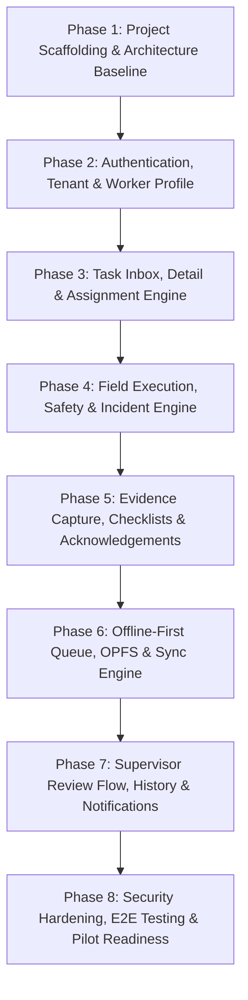

# EVORA Field Worker Portal — Phased Implementation Plan

> **Document:** `phases.md`  
> **Workspace Path:** `Evora/Evora-Worker/`  
> **Reference Baseline:** Integrated Product Specification (Part IV & Part V)  
> **Status:** Implementation Blueprint  

---

## 🗺️ Master Architecture & Phasing Overview

The **EVORA Field Worker Portal (`Evora-Workers`)** is built as an offline-ready **Flutter mobile application (Android & iOS)** designed for harsh field operating conditions, spotty cellular connectivity, and strict municipal accountability.

---

## 📋 Phase Breakdown

---

### Phase 1: Project Scaffolding & Core Architecture Baseline
**Objective:** Establish the foundational workspace, dependency tree, responsive mobile-first UI shell, routing, and shared type contracts.

* **Key Deliverables:**
  1. **Workspace Setup:**
     * Clean PWA project scaffolding (service worker lifecycle, manifest.json, install prompts).
     * Unified theme system aligned with EVORA design guidelines (high-contrast outdoor legibility, color-blind safe status tokens).
  2. **Core Navigation Shell (6 Views):**
     * `My Overview` (`/overview`)
     * `My Tasks` (`/tasks`)
     * `Task Map` (`/map`)
     * `Notifications` (`/notifications`)
     * `Task History` (`/history`)
     * `Profile & Help` (`/profile`)
  3. **Shared Contracts & Enums (`contracts/`):**
     * `TaskStatus`: `assigned`, `accepted`, `in_progress`, `blocked`, `submitted_for_review`, `returned`, `approved`, `cancelled`, `reassigned`.
     * `TaskPriority`: `P1`, `P2`, `P3`, `P4`.
     * `SourceType`: `CIVIC_FLOW_CASE`, `MUNICIPAL_WORK_ORDER`, `PREVENTIVE_MAINTENANCE`, `CAMPAIGN`.
     * `DeclineReason`: `OUT_OF_AREA`, `SKILL_MISMATCH`, `WORKLOAD_CONFLICT`, `EQUIPMENT_UNAVAILABLE`, `SAFETY_CONCERN`, `OTHER`.
     * `BlockReason`: `UNSAFE_SITE`, `ACCESS_RESTRICTED`, `WEATHER_CONDITION`, `EQUIPMENT_FAILURE`, `MATERIAL_UNAVAILABLE`, `AWAITING_AUTHORITY`, `OTHER`.
     * `AcknowledgementStatus`: `NOT_REQUIRED`, `PENDING`, `CONFIRMED`, `DISPUTED`, `CITIZEN_UNAVAILABLE`.
  4. **State Management & Local Store Layer:**
     * Reactive state stores configured for tasks, network status, and active operations.
* **Exit Criteria:** App boots cleanly on mobile viewport; bottom navigation switches routes with zero layout shift; full TypeScript/Dart type safety in place.

---

### Phase 2: Authentication, Tenant Context & Worker Identity
**Objective:** Implement municipally provisioned phone OTP authentication, session lifecycle, and worker identity boundaries.

* **Key Deliverables:**
  1. **Phone Number OTP Login Flow:**
     * Phone input screen with country code and formatting.
     * 6-digit OTP verification screen with cooldown timers and retry limits.
     * Prevention of public self-registration (verifies pre-provisioned records in `tenants/{tenantId}/members/{uid}`).
  2. **Tenant & Scope Resolution:**
     * Fetch worker tenant membership, assigned `departmentId`, `teamId`, and authorized `serviceAreas`.
     * Session validation and device fingerprinting.
  3. **Immediate Revocation Handling:**
     * Listeners/interceptors checking account active status on every request.
     * Automatic logout and local session purging when an account is disabled.
  4. **Profile & Crew Screen (`/profile`):**
     * Display worker name, phone, municipal employee ID, assigned department, crew name.
     * Emergency supervisor contact shortcut and secure Sign Out action.
* **Exit Criteria:** Only provisioned worker phone numbers can log in; unassigned numbers are rejected with clear contact instructions; session expires gracefully.

---

### Phase 3: Task Inbox, Detail & Assignment Engine
**Objective:** Deliver real-time task ingestion, individual assignments, atomic team-pool claiming, and task detail views.

* **Key Deliverables:**
  1. **My Overview (`/overview`):**
     * Today's task count, urgent/overdue indicators, connectivity status banner.
     * Priority cards for quick dispatch.
  2. **My Tasks Inbox (`/tasks`):**
     * Filterable queue tabs: `Assigned`, `Accepted`, `In Progress`, `Blocked`, `Under Review`.
     * Filtering by priority, due date, category, and ward/service area.
     * Infinite scrolling or cursor-based pagination.
  3. **Assignment State Transitions:**
     * **Individual Tasks:** Server-validated `acceptTask` and `declineTask` (requiring mandatory reason selection).
     * **Team Pool Tasks:** Atomic `claimTask` transaction (locks task to claiming worker; handles concurrent claim collisions gracefully).
     * **Pool Task Dismissal:** Dismissing an unclaimed pool task logs to `workerResponses/{uid}` and hides it from that worker without canceling it for the crew.
  4. **Task Detail View (`/tasks/:id`):**
     * Header: Task ID, priority badge, SLA remaining timer, category.
     * Location card: Landmark, address, ward, coordinates, external navigation button.
     * Work instructions, precautions, and equipment requirements.
* **Exit Criteria:** Workers can view assigned work, accept/decline tasks, and claim team-pool items atomically without race conditions.

---

### Phase 4: Field Execution, Safety & Incident Engine
**Objective:** Empower workers to manage active execution states, report operational blockers, and immediately escalate critical safety hazards out-of-band.

* **Key Deliverables:**
  1. **Execution State Actions:**
     * `startTask`: Transitions `accepted` $\rightarrow$ `in_progress` with timestamp and optional on-site GPS verification.
     * `pauseTask` / `resumeTask`.
  2. **Operational Blocker Dialog (`blockTask`):**
     * Selection of structured reason (`WEATHER_CONDITION`, `ACCESS_RESTRICTED`, etc.).
     * Optional blocker photograph and operational note.
     * Transitions task to `blocked` (reflects on Citizen case as `Delayed + explanation`).
  3. **Supervisor Help Request (`requestSupervisorHelp`):**
     * In-task advisory flag requesting supervisor callback or equipment assistance without pausing work.
  4. **High-Priority Safety Incident Reporting (`reportSafetyIncident`):**
     * **Dedicated out-of-band action:** Creates an un-blockable record in `tenants/{tenantId}/safetyAlerts/{alertId}`.
     * Captures hazard type, immediate risk level, notes, and optional photo.
     * Bypasses normal queues to trigger urgent supervisor FCM notification.
     * **Instant emergency panel:** Displays police, ambulance, and municipal emergency dispatch numbers directly—no network wait required.
  5. **Task Map / Work Area View (`/map`):**
     * Interactive map showing assigned task pins and approved service area boundaries.
     * One-tap external navigation launcher (Google Maps / Apple Maps).
     * Textual turn-by-turn fallback for offline navigation.
* **Exit Criteria:** Distinct operational block and safety incident flows functioning independently; emergency contacts always accessible.

---

### Phase 5: Evidence Capture, Checklists & Acknowledgements
**Objective:** Build the evidentiary subsystem required for verifiable work completion and supervisor audit.

* **Key Deliverables:**
  1. **Photo & Document Evidence Pipeline:**
     * Camera integration and image file validation (JPEG, PNG, WebP up to 10 MB).
     * Document attachment support (PDF up to 20 MB).
     * Categorization: Before photos (0–5) and After photos (1–5) based on category rules.
     * Client-side image compression and metadata preservation (timestamp, geolocation).
  2. **Subcollection Data Separation:**
     * Store photo/document metadata in `tasks/{taskId}/evidence/{evidenceId}`.
     * Store actual binaries in Cloud Storage (`tenants/{tenantId}/tasks/{taskId}/...`).
  3. **Dynamic Task Checklists:**
     * Category-specific checklist items loaded from `taskTemplates`.
     * Item completion toggles with mandatory reason inputs if marked `N/A`.
     * Stored in `tasks/{taskId}/checklistResponses/{itemId}`.
  4. **Structured Measurements:**
     * Category-specific numerical/unit fields (e.g., area repaired in $m^2$, weight collected in $kg$).
     * Stored in `tasks/{taskId}/measurements/{measurementId}`.
  5. **Citizen Acknowledgement:**
     * In-app citizen confirmation workflow.
     * State handling: `NOT_REQUIRED`, `PENDING`, `CONFIRMED`, `DISPUTED`, `CITIZEN_UNAVAILABLE`.
     * Stored in `tasks/{taskId}/acknowledgements/{ackId}`.
  6. **Completion Submission (`submitTaskCompletion`):**
     * Validation that all required evidence, checklists, and measurements are fulfilled.
     * Moves task to `submitted_for_review`.
* **Exit Criteria:** Incomplete tasks cannot be submitted; evidence is structured in subcollections; completion moves task to review queue.

---

### Phase 6: Offline-First Queue, OPFS & Sync Engine
**Objective:** Ensure full operational continuity when workers enter basements, remote roads, or areas with zero cellular signal.

* **Key Deliverables:**
  1. **Encrypted Local Storage (IndexedDB):**
     * Encrypted cache for active assigned tasks and task templates.
     * Configurable 24-hour cache TTL with auto-pruning.
  2. **Media Staging (OPFS / IndexedDB Blobs):**
     * Store captured evidence photos locally before upload.
     * Retain blob references until upload and Cloud Storage confirmation succeed.
  3. **Idempotent Command Queue:**
     * Queue offline commands (`acceptTask`, `updateTaskProgress`, `blockTask`, `submitTaskCompletion`).
     * Assign client-generated `operationId` and `idempotencyKey` to every transaction.
  4. **Reconnection & Sync Coordinator:**
     * Background service listening to network connectivity events.
     * Sequential execution of queued operations with exponential backoff on retry.
     * **Conflict Resolution (`WRK-OFF-04`):** If a task was reassigned or cancelled on the server while the worker was offline, reject the local mutation, notify the worker, and request supervisor guidance.
  5. **Offline UX Indicators:**
     * Real-time network status pill (Online / Offline / Syncing).
     * Pending upload counters and sync failure indicators with manual retry triggers.
* **Exit Criteria:** App functions offline through complete task execution, photo capture, and completion submission; queues replay cleanly upon reconnection.

---

### Phase 7: Supervisor Review Flow, History & Notifications
**Objective:** Implement task history, notifications, and the feedback loop between supervisor reviews and citizen cases.

* **Key Deliverables:**
  1. **Task History Screen (`/history`):**
     * Complete record of resolved, returned, reassigned, and cancelled tasks.
     * Detail view displaying submitted evidence, supervisor review comments, and closure timestamps.
  2. **Supervisor Review Feedback Handling:**
     * **Supervisor Approval:** Supervisor marks task `approved` $\rightarrow$ triggers CivicFlow case transition to `resolved` and notifies citizen.
     * **Supervisor Return:** Supervisor returns task with rework reasons $\rightarrow$ moves task back to `returned` / `in_progress` with actionable correction notes.
  3. **Notification Center (`/notifications`):**
     * In-app inbox for assignment updates, SLA threshold warnings, and supervisor review outcomes.
     * Mark as read, batch dismissal, and direct navigation to referenced tasks.
  4. **Push Notifications (FCM):**
     * Background push notification receiver for critical dispatch and schedule changes.
* **Exit Criteria:** Reworked tasks display supervisor feedback clearly; approved tasks trigger end-to-end case resolution; notifications link directly to task views.

---

### Phase 8: Security Hardening, E2E Testing & Pilot Readiness
**Objective:** Validate performance, multi-tenant isolation, data privacy, and field reliability prior to municipal pilot deployment.

* **Key Deliverables:**
  1. **Multi-Tenant & Security Testing:**
     * Strict verification that workers can never read tasks or data outside their assigned `tenantId`.
     * Zero leakage of citizen contact details, home addresses, or private internal notes to the worker PWA.
  2. **Offline & Edge-Case Testing:**
     * Airplane mode simulations: task progression, photo capture, conflict generation, and recovery.
     * Large file upload interruption and automated retry tests.
  3. **Accessibility & Device Performance:**
     * WCAG 2.1 AA compliance (touch target sizes $\ge 48\times 48$ dp, scalable fonts, daylight contrast).
     * Performance budget: PWA initial load $< 2.5$s on 4G network; bundle size optimization.
  4. **Operational Runbook & Definition of Done:**
     * Worker onboarding and device troubleshooting guide.
     * Verification against Appendix C (Definition of Done) from the master specification.
* **Exit Criteria:** 100% test suite pass rate; multi-tenant security verification passed; PWA installable and validated on iOS Safari and Android Chrome.

---

## 📅 Suggested Implementation Sequencing Matrix

| Phase | Description | Est. Scope | Dependencies |
| :---: | :--- | :---: | :---: |
| **Phase 1** | Project Scaffolding & Core Architecture Baseline | Foundation | None |
| **Phase 2** | Authentication, Tenant & Worker Profile | Core Auth | Phase 1 |
| **Phase 3** | Task Inbox, Detail & Assignment Engine | Core Workflows | Phase 1, 2 |
| **Phase 4** | Field Execution, Safety & Incident Engine | Execution | Phase 3 |
| **Phase 5** | Evidence Capture, Checklists & Acknowledgements | Data & Storage | Phase 3, 4 |
| **Phase 6** | Offline-First Queue, OPFS & Sync Engine | Offline Core | Phase 3, 4, 5 |
| **Phase 7** | Supervisor Review Flow, History & Notifications | Review & Audit | Phase 5, 6 |
| **Phase 8** | Security Hardening, E2E Testing & Pilot Readiness | Quality & Launch | All Phases |

---

*This document is the official implementation roadmap for `Evora-Worker`. Changes to workflow states, data models, or phase boundaries must be updated here.*
